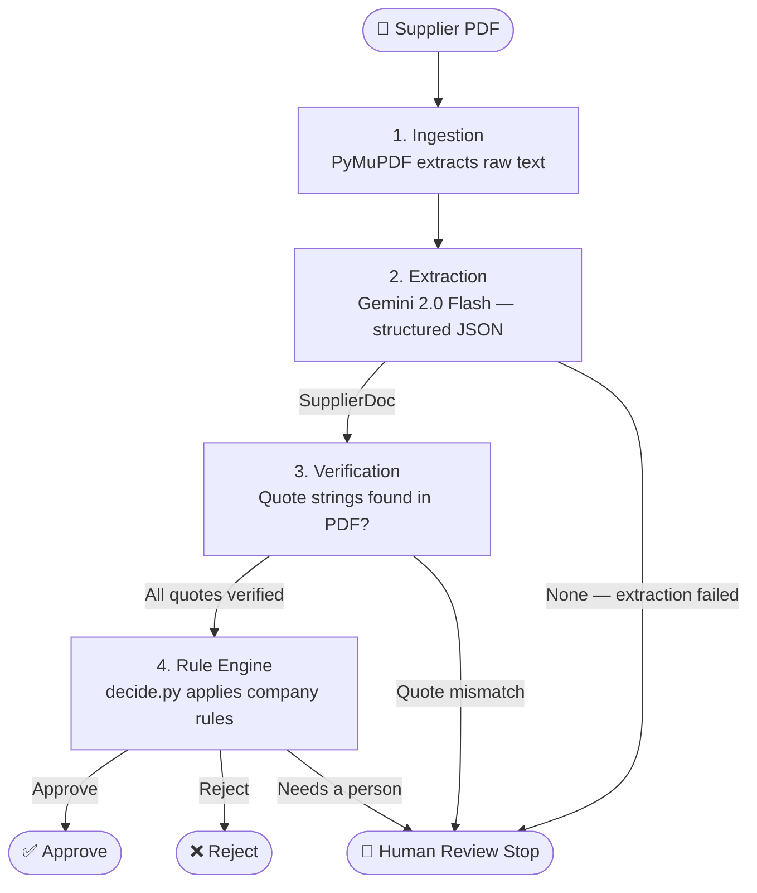
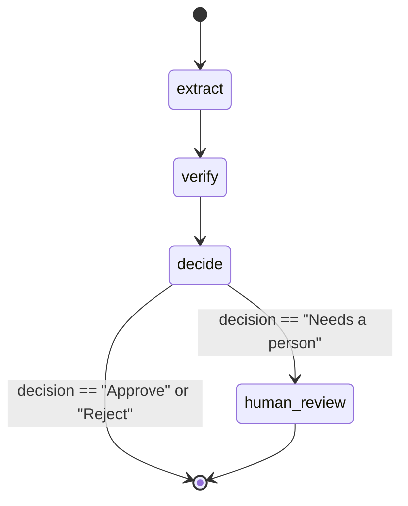
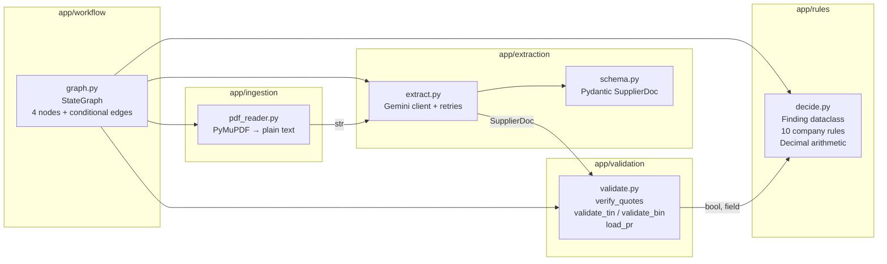
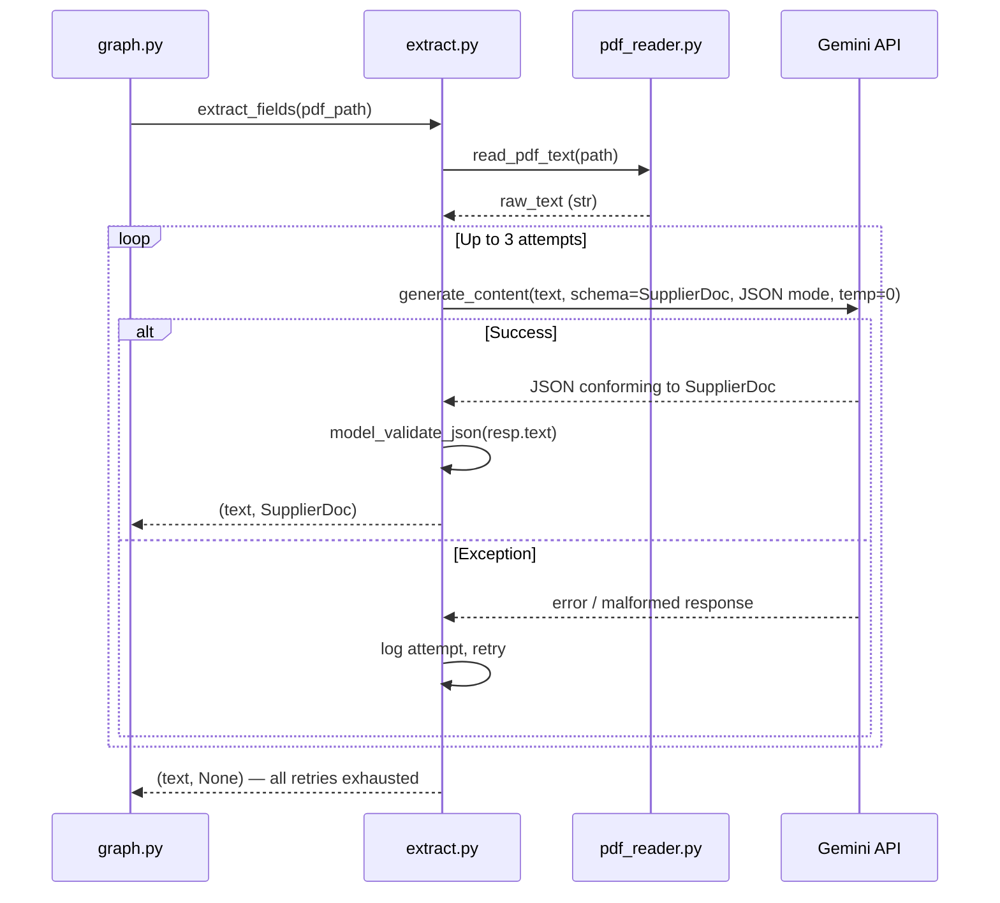
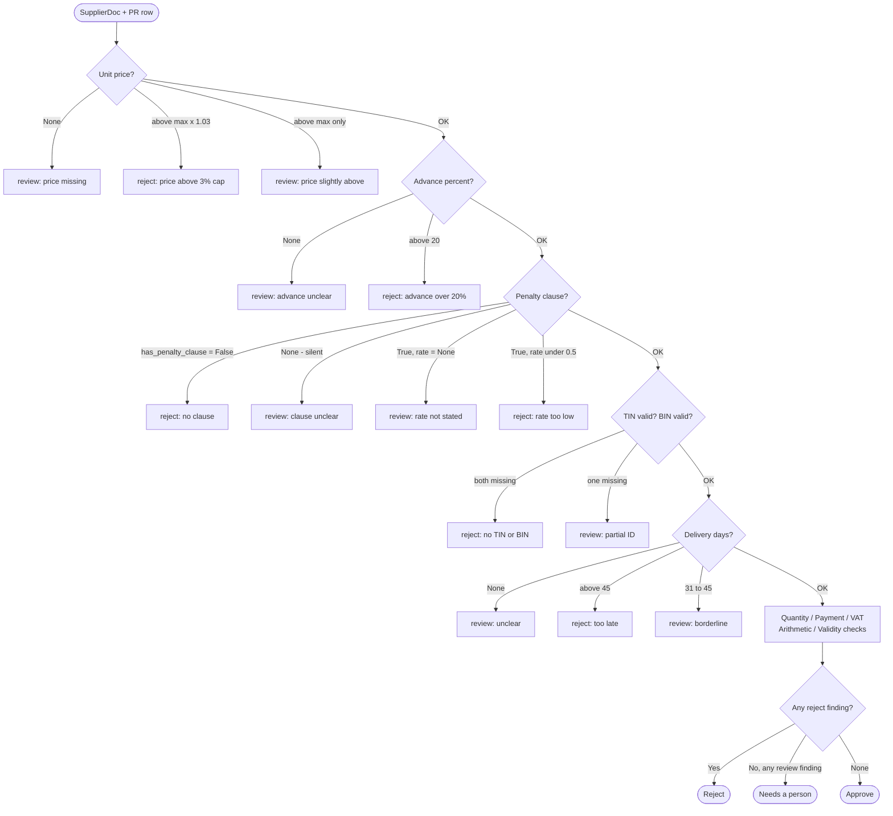
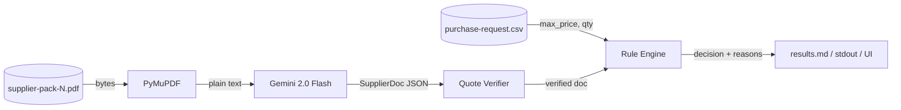
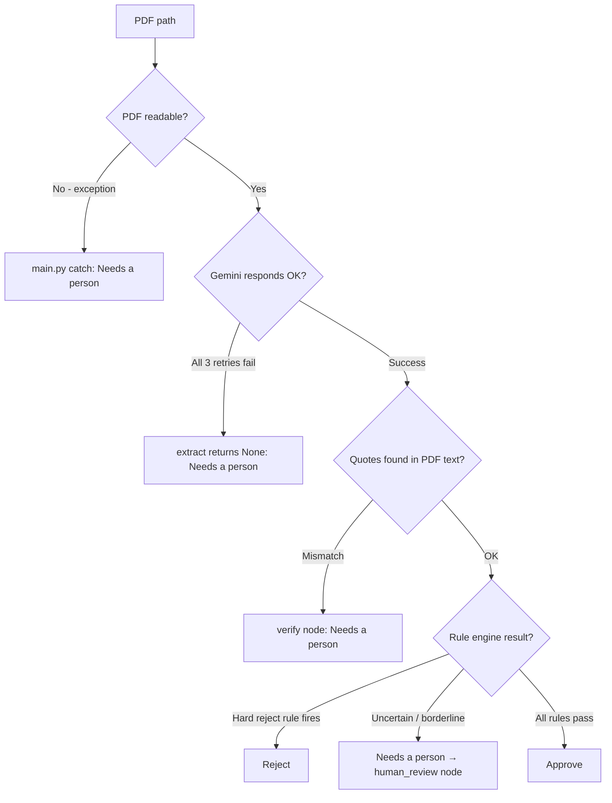
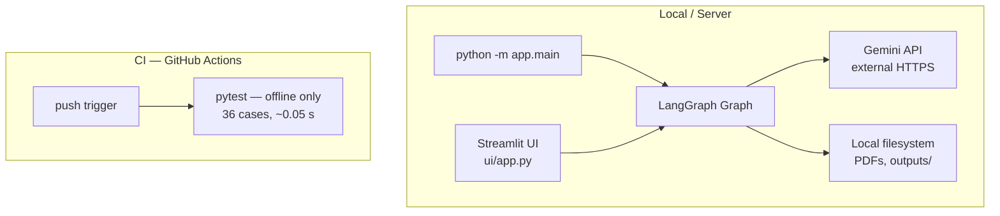

# System Architecture – AI Supplier Document Checker

## 1. High-Level Overview

The system is a **deterministic, step-by-step AI pipeline** built with LangGraph.
It never runs an agent "freely" — every step is a named node with a fixed responsibility.



---

## 2. LangGraph State Machine

The graph is compiled from a `StateGraph`. Each node receives the full state dict
and returns only the keys it updates — nothing is mutated in place.



### State schema

```
State
├── pdf_path    : str          – input PDF file path
├── text        : str          – raw extracted text (set by extract)
├── doc         : SupplierDoc? – structured fields (set by extract, None on failure)
├── ok          : bool         – quote verification result (set by verify)
├── fail_field  : str          – first failing field name (set by verify)
├── decision    : str          – Approve / Reject / Needs a person (set by decide)
├── reasons     : list[str]    – human-readable explanations (set by decide)
└── quotes      : list[str]    – supporting evidence strings (set by decide)
```

---

## 3. Component Architecture



---

## 4. Extraction Sequence



**Why JSON mode + response_schema?**
Gemini's `response_mime_type="application/json"` forces the model to output valid JSON.
Passing `response_schema=SupplierDoc` additionally constrains the JSON to match the
Pydantic model's shape — field names, types, nullability — so `model_validate_json`
never fails due to a structural mismatch.

---

## 5. Rule Engine Decision Tree



---

## 6. Full Data Flow



---

## 7. Error Handling Architecture



---

## 8. Package Structure

```
Ai_Procuremnet_project/
├── app/
│   ├── __init__.py
│   ├── main.py                  ← CLI entry point
│   ├── extraction/
│   │   ├── schema.py            ← Pydantic SupplierDoc model
│   │   └── extract.py           ← Gemini client, retries, JSON mode
│   ├── ingestion/
│   │   └── pdf_reader.py        ← PyMuPDF wrapper
│   ├── rules/
│   │   └── decide.py            ← business rule engine
│   ├── validation/
│   │   └── validate.py          ← quote verifier, TIN/BIN validators
│   └── workflow/
│       └── graph.py             ← LangGraph StateGraph
├── data/
│   ├── supplier_pdf/            ← 10 sample PDFs
│   ├── purchase-request.csv
│   └── company-rules.md
├── tests/
│   └── test_decisions.py        ← offline parametrised unit tests (36 cases)
├── outputs/                     ← cached JSON extractions (auto-created)
├── evaluate.py                  ← LLM end-to-end evaluation
├── conftest.py                  ← pytest sys.path fix
├── .env / .env.example
├── requirements.txt
├── README.md
├── NOTE.md
├── ARCHITECTURE.md              ← this file
└── IMPLEMENTATION_GUIDE.md
```

---

## 9. Technology Choices Rationale

| Technology | Role | Why chosen |
|---|---|---|
| **LangGraph** | Orchestration | Enforces fixed node order; state is explicit; nodes are auditable |
| **Gemini 2.0 Flash** | Field extraction | Fast, cheap, current model; supports JSON mode + response_schema |
| **google-genai SDK** | Gemini client | Current SDK; `google-generativeai` is deprecated |
| **Pydantic v2** | Schema + validation | `model_validate_json` + `model_json_schema` = zero boilerplate |
| **PyMuPDF** | PDF reading | Fast, no system deps; returns clean per-page text |
| **Decimal** | Price arithmetic | Avoids IEEE 754 rounding errors at the 3% price boundary |
| **pytest + parametrize** | Testing | Each scenario reports independently; completely offline and free |

---

## 10. Deployment Topology


